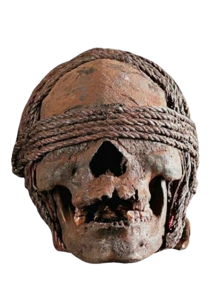

 
 
 
  
 
 
 

<table>
  <tr>
    <td align="center" valign="middle" width="30%">
      
    </td>
    <td valign="top" width="70%">
      <h2>
         
        About Me
      </h2>
      
My name is Maksym. 17 yo.

      
Been into programming since childhood. 
      Now i am taking it seriuosly, for past 5 month i have learned basics and not only basics of ASP.NET Web API, Docker, Postgres, HTML, CSS, JS. And using these to build mine own applications.

      
Can do various types of sites from just visit cards to a big bussines applications where you need to work with a lot of data. 
      Looking forward to learn new things so I build not only sites.

      
Studying in MediaCollege Amsterdam with MBO 4 level on the second year.

    </td>
  </tr>
</table>

<h2>
 ⚔️ Tech Stack
</h2>

 

